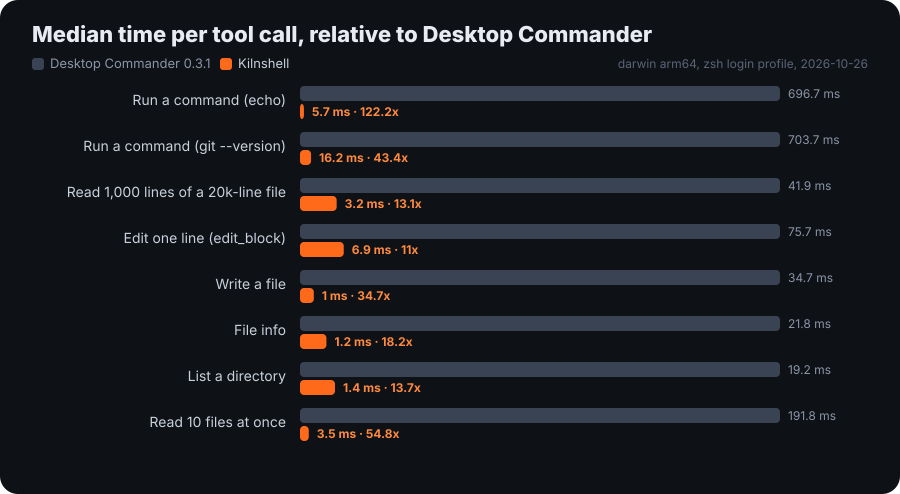

<p align="center">
  
</p>

<h3 align="center">Your whole machine, for AI agents. Without the wait.</h3>

<p align="center">
  Terminal, files, code search, long-running processes, PDF, Excel and Word, over MCP.<br>
  Everything Desktop Commander does, up to 100x faster per call, with no telemetry and nothing injected into your agent's context.
</p>

<p align="center">
  <a href="https://github.com/Soflutionltd/kilnshell/actions/workflows/ci.yml"></a>
  
  
  
  
</p>

---

## Benchmark

<p align="center"></p>

| Tool call | Desktop Commander 0.3.1 | Kilnshell | Speed-up |
|---|---:|---:|---:|
| Run a command (`echo hi`) | 696.7 ms | 5.7 ms | **122x** |
| Run a command (`git --version`) | 703.7 ms | 16.2 ms | **43x** |
| Read 1,000 lines of a 20k-line file | 41.9 ms | 3.2 ms | **13x** |
| Edit one line (`edit_block`) | 75.7 ms | 6.9 ms | **11x** |
| Write a file | 34.7 ms | 1.0 ms | **35x** |
| File info | 21.8 ms | 1.2 ms | **18x** |
| List a directory | 19.2 ms | 1.4 ms | **14x** |
| Read 10 files at once | 191.8 ms | 3.5 ms | **55x** |

MacBook Pro (Apple Silicon), macOS, zsh with a typical developer profile (Homebrew and nvm), Node 25, median of 9 calls over real MCP stdio, telemetry turned off in the Desktop Commander config. The command speed-up depends on your shell profile: the heavier it is, the bigger the gain. On a bare Linux machine with an empty profile, commands are about 3x faster and file tools 3x to 6x faster.

Reproduce it on your machine:

```bash
git clone https://github.com/Soflutionltd/kilnshell && cd kilnshell
npm install
npm run bench        # installs Desktop Commander 0.3.1 next to it, runs both, redraws the chart
```

## What changed, and why it is faster

Kilnshell started as a clone of [Desktop Commander](https://github.com/wonderwhy-er/DesktopCommanderMCP) 0.3.1, profiled call by call.

1. **The shell profile is read once, not on every command.** Desktop Commander starts every command as `zsh -l -c ...`, so a profile that loads nvm, pyenv or Homebrew costs 0.5 to 1 s per command. Kilnshell runs the login profile once at start-up, keeps the environment it produces (same `PATH`, same variables) and starts each command with `zsh -c`. Set `DESKTOP_COMMANDER_LOGIN_ENV_CACHE=0` to get a fresh login shell every time.
2. **No process is spawned behind your back on every call.** Telemetry rebuilt its system report for each tool call, which ran `python3 --version` synchronously and froze the server for 10 to 25 ms, even with telemetry turned off. System facts are now computed once.
3. **Line counting uses native string scanning.** Reading, editing and inspecting a file counted its lines character by character; the new count gives identical results (checked on 200,000 random inputs) about 11x faster on large files.
4. **No debug chatter.** Every call used to push two to four `[FEEDBACK DEBUG]` log notifications to the client.
5. **Fewer round trips.** For an agent, each tool call costs a full round trip, often far more than the command itself. Kilnshell adds:
   - `batch`: several tool calls (commands, reads, edits, searches) in one request, results numbered in order;
   - `read_process_output` with `wait_for_exit: true`: waits for the process to end and returns all its output at once, instead of polling;
   - `start_search` with `wait: true`: returns every result in one call, instead of `start_search` then `get_more_search_results`;
   - `wait_for`: waits until a port accepts connections, a file exists, a URL answers or a process exits, instead of sleep loops.
6. **Works at full speed inside Claude Desktop.** Claude Desktop runs extensions in its own Node; the environment is captured with `env -0`, so the profile cache works there too, and Claude's `ELECTRON_*` variables never reach your commands.

## What was removed

| Upstream behaviour | Kilnshell |
|---|---|
| Usage telemetry sent to the Desktop Commander servers | Removed. Kilnshell makes no network call of its own. |
| Feature flags downloaded every 5 minutes from desktopcommander.app | Built-in defaults only (`KILNSHELL_FLAG_URL` to host your own). |
| `[SYSTEM INSTRUCTION]` text appended to tool results, asking the model to request feedback or promote a Docker setup | Removed. Tool results contain only the tool's output. |
| Welcome page opened in the browser on first run | Removed. |
| `give_feedback_to_desktop_commander` tool | Hidden. |
| `remote` mode (relies on the Desktop Commander cloud service) | Not available. |

Everything else is the same code: the same tools, the same arguments, the same config file (`~/.claude-server-commander/config.json`), so Kilnshell is a drop-in replacement. The new tools and options are additions only.

## Install

**Claude Desktop:** download [`kilnshell.mcpb`](https://github.com/Soflutionltd/kilnshell/releases/latest/download/kilnshell.mcpb) and double-click it (or Settings > Extensions > Advanced settings > Install Extension). The Kilnshell icon then shows next to every tool call.

**Claude Code:** `/plugin install kilnshell --marketplace Soflutionltd/kilnshell`

Also listed in the official [MCP Registry](https://registry.modelcontextprotocol.io/v0/servers?search=com.soflution/kilnshell) as `com.soflution/kilnshell`.

Cursor or any MCP client:

```json
{
  "mcpServers": {
    "kilnshell": {
      "command": "npx",
      "args": ["-y", "github:Soflutionltd/kilnshell"]
    }
  }
}
```

Or from a local clone, which starts faster than `npx`:

```bash
git clone https://github.com/Soflutionltd/kilnshell && cd kilnshell && npm install
```

```json
{ "mcpServers": { "kilnshell": { "command": "node", "args": ["/absolute/path/to/kilnshell/dist/index.js"] } } }
```

## Tools

| Area | Tools |
|---|---|
| Speed | `batch` (several calls in one), `wait_for` (port, file, URL, process) |
| Terminal | `start_process`, `interact_with_process`, `read_process_output` (`wait_for_exit`), `list_sessions`, `list_processes`, `force_terminate`, `kill_process` |
| Files | `read_file`, `read_multiple_files`, `write_file`, `edit_block`, `create_directory`, `list_directory`, `move_file`, `get_file_info` |
| Search | `start_search` (`wait`), `get_more_search_results`, `stop_search`, `list_searches` (ripgrep) |
| Documents | `write_pdf`, plus reading and editing PDF, Excel and Word files through `read_file`, `write_file` and `edit_block` |
| Config | `get_config`, `set_config_value`, `get_usage_stats`, `get_recent_tool_calls` |

Security controls are unchanged: `allowedDirectories`, `blockedCommands`, file read and write line limits, all in the config file.

## Develop

```bash
npm install
npm run build
npm test            # the full upstream test suite (takes several minutes)
npm run bench       # Kilnshell vs Desktop Commander on this machine
```

## Credits and license

Kilnshell is built on [Desktop Commander](https://github.com/wonderwhy-er/DesktopCommanderMCP) by Eduard Ruzga and the Desktop Commander contributors, released under the MIT license. Their full history is kept in this repository. Kilnshell is an independent project, not affiliated with or endorsed by them.

MIT, © 2024-2025 Eduard Ruzga and Desktop Commander Contributors, © 2026 Soflution Ltd. See [LICENSE](LICENSE).

## En français

Kilnshell est un serveur MCP qui donne à un agent IA l'accès à votre machine : terminal, fichiers, recherche dans le code, processus, PDF, Excel et Word. C'est un clone de Desktop Commander, optimisé appel par appel : jusqu'à 100 fois plus rapide sur un Mac de développeur, sans aucune télémétrie, et sans texte publicitaire injecté dans les réponses données à l'agent. Il se remplace d'une ligne dans la configuration de Claude.
