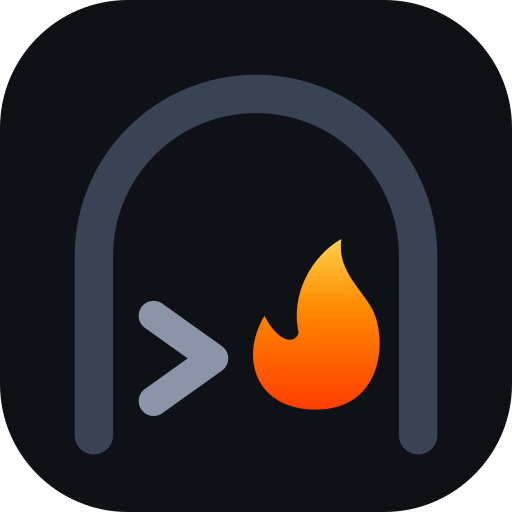

# Kilnshell

Kilnshell gives Claude your terminal and your files on your own machine: run commands and long-running processes, read, write and edit files precisely, search code and file contents with ripgrep, and work with PDF, Excel and Word documents. It is a performance-focused, telemetry-free fork of Desktop Commander, published by Soflution Ltd under the MIT license.

## Install

In Claude Code:

```
/plugin install kilnshell --marketplace Soflutionltd/kilnshell
```

In Claude Desktop, download `kilnshell.mcpb` from the [latest release](https://github.com/Soflutionltd/kilnshell/releases/latest) and double-click it.

## What it runs

The plugin starts one local MCP server over stdio: the `kilnshell` npm package, always the latest version (`npx -y kilnshell@latest`), which then updates itself while it runs. Its source code is in this repository.

## What it sends and fetches

- No telemetry, no analytics, no usage tracking: nothing about you or your files leaves your machine.
- No remote feature flags unless you set `KILNSHELL_FLAG_URL` to a file you host yourself.
- Commands you ask it to run can reach the network like any program in your terminal.
- Writing a PDF needs Chrome: if no Chrome is installed, the first `write_pdf` downloads Chrome for Testing from Google's servers through `@puppeteer/browsers`, once.
- Reading a URL with `read_file` fetches that URL, only when you ask for it.

## Speed

Commands start up to 100 times faster than Desktop Commander because the login shell environment is resolved once instead of for every command. See the benchmark in the [repository](https://github.com/Soflutionltd/kilnshell).

## Safety

Kilnshell can do anything your user account can do on this machine. Review commands before approving them, and use allowed directories and blocked commands (`set_config_value`) to restrict it.
